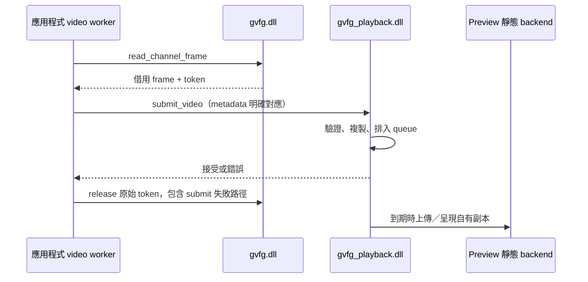

# GVFG 影音資料流與生命週期

更新於 2026-10-20。公開使用範例見 [Playback 手冊](GVFG_PLAYBACK_API.md)，
內部 scheduling 見 [Playback 維護說明](../GVFG_SDK/helpers/gvfg_playback/README.md)。

## 1. Capture 與 Playback 是兩個生命週期

```text
Capture:  create → open channel → set audio / format → start → read / release → stop → destroy
Playback: create → attach HWND（可選）→ start config → submit copies → stop → destroy
```

Capture 保有裝置、channel 與借用 token；Playback 保有播放副本與輸出。
兩者不互相代替 stop。多 channel 共用 Capture handle 時，不得因停止一條就 destroy 其他 channel 的 handle。

## 2. 每張影像的 ownership



copy／zero-copy 都要求正確 read/release。啟用 OSD 等 SDK 處理時，交付 pointer 也可能是 SDK-owned buffer，
不能只從 zero-copy 選項推定最後交付位址。公開 token 不可修改後再拿去 release。
Playback 的複製不代表整條擷取管線都是 zero-copy，也不等於錄影端已取得副本。

## 3. PCM ownership

每條 channel 同時最多持有一個成功讀出的音訊 frame。
SDK 配置交付 buffer；Playback 接受 PCM16 後另有自己的副本。
應用程式可直接 submit 後 release，或先 copy、release 再 submit 自有 PCM。
音訊與影像分開 read，不能用 video read 成功推論 PCM 有持續流動。

## 4. 播放狀態

| 狀態 | 行為 |
|---|---|
| 已 create、未 start | 可綁窗／設定音量；有視窗時可 present_image |
| start 後初始緩衝 | 等啟用串流與時間覆蓋範圍；音訊暫停，先準備 GPU |
| 播放中 | 根據 master 排程，音訊補足小段輸出 lead，影像到期才提交 |
| 重新緩衝 | 覆蓋範圍用盡，暫停共同時鐘與音訊，等待補足 |
| 持續輸出錯誤 | last_error 保存錯誤，後續 submit 回報，等待 caller 處理 |
| stop | join worker、清 queue、結束音訊輸出；保留可重用的 Preview 物件 |
| destroy | stop，再銷毀 Preview 與 handle |

`running=1` 只表示 session 已啟動，不能取代 last_error 檢查。
External／Audio master 的過期預覽可退休；未到期 frame 不提前顯示，音訊不因此任意丟包。
隱藏預覽仍消化影像時間軸，不可停止 video submit 卻保留影音模式。

## 5. 停止的應用程式順序

1. 設定自己的 producer stop flag。
2. 等 read timeout 或正常返回；成功 read 的 token 完成使用並 release。
3. join video／audio 讀取執行緒。
4. 停止／銷毀 Playback。
5. 停止 Capture channel；所有 channel 結束後銷毀 Capture handle。
6. 釋放 HWND。

不要讓 UI thread 在 worker 還使用 SDK pointer 或 HWND 時先銷毀它們。
DXGI 可能送同步 HWND 訊息；現有 SDK 等待路徑處理 sent messages，caller 仍須遵守 UI thread 與視窗 lifetime。

## 6. 事件、重連與格式改變

Capture 透過 `gvfg_poll_channel_event()` 回報格式與插拔事件。
應用程式更新畫面與格式資訊，協調 producer 並重設播放時間軸，不能把重連資料接到舊 epoch。
reset 會 stop、清除畫面，原本 active 時再用原 config start；每一步都可能失敗。
音訊格式變動應以新 audio_format 做 stop/start，而不是只呼叫沿用舊 config 的 reset。

Capture backend 自身的恢復與 Playback 輸出裝置恢復是不同邊界；不能把舊 QAudioSink 重建策略套到目前 WASAPI backend。
目前播放輸出沒有自動切換／重建預設裝置的契約。

## 7. 計數與完整性

Capture 交付數、Playback 接受數、處理數、成功 Present 數與預覽略過數是不同指標。
`video_processed` 包含隱藏消化與略過；`video_dropped` 不代表 driver 漏 frame。
stop/reset 會取消 queue，不能要求所有 submitted 最後都變成 presented。
目前 API 用於持續預覽，沒有 EOS/drain，也沒有 lossless playback 的宣告。

完整 Viewer 的錄影採獨立副本／recorder queue；預覽略過不代表錄影也刪同張。
錄影是否成功仍須由 recorder 自己的結果判斷，不能借用預覽 FPS 或略過數代替。
