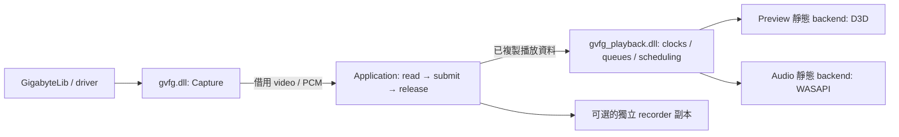

# GVFG 擷取與播放物件架構

更新於 2026-10-20，依目前原始碼整理。完整閱讀順序見 [學習入口](GVFG_LEARNING_INDEX.md)。
本版以目前可查證的物件與邊界說明，不把概念欄位當成公開 ABI。

## 1. 兩個公開 handle

| Handle | 建立／銷毀 | 責任 |
|---|---|---|
| `gvfg_handle` | `gvfg_create`／`gvfg_destroy` | 裝置、CH0／CH1、read/release、訊號與事件 |
| `gvfg_playback` | `gvfg_playback_create`／`gvfg_playback_destroy` | 一組播放 session、模式、影音副本、共同時間軸與輸出 |

兩者都是 opaque pointer。使用者看得到 handle 型別，不需要依賴內部 C++ 成員。
通常每條需要獨立播放的 channel 建一個 Playback handle；它不接管 Capture handle。

## 2. Capture 內部

目前 `sdk/gvfg/src/gvfg_capture.cpp` 的 `gvfg_handle_t` 保存 channel errors、
device path/index、`channels`、zero-copy 請求與影像格式設定。
`channels` 是持有 `unique_ptr<gvfg_channel_session_t>` 的固定兩格陣列。
沒有 open 的 channel 沒有對應 session；不可把 handle 本身當成影像 buffer。

每個 `gvfg_channel_session_t` 透過 `unique_ptr<GigabyteCaptureSession> session`
持有 vendor adapter，另有 running、read／held token、音訊 buffer、訊號與事件狀態。
目前物件名稱是 `session`，不是舊文件示意的 `backend`。

`GigabyteCaptureSession` 透過 vendor API 取得影音與事件；SDK facade 負責將資料轉成
公開結構，驗證 frame token，加入交付時間與 runtime 統計。
底層連線與 vendor context 不是客戶契約，也不承諾固定的 Win32 HANDLE 數量；
讀原始碼時從 `open_device_*`、`wait_frame`、`wait_audio`、`stop_stream` 追蹤。

## 3. Playback 內部

`helpers/gvfg_playback/src/gvfg_playback.cpp` 的 `gvfg_playback_t` 同時持有：

- config、共同 stats、mutex／condition variable 與共用 worker。
- video／audio deque 與容量計數。
- Preview handle 與 Audio player。
- External／Video clock、AudioTimeline、DriftFilter。

`playback_timing.h` 處理時間換算與狀態；AudioTimeline 把已消耗 sample frames 對應到來源 PTS。
Audio backend 只知道 PCM、已播／待播 frames、暫停與速率指令，不比較影像時間。
Preview backend 只知道影像上傳與呈現，不決定哪一路當 master。

`unique_ptr` 表示單一 ownership；Playback 的兩個低階 opaque handle 由 stop/destroy 路徑明確回收。
這與指標指向的影像資料是否已複製是不同問題。

## 4. DLL 與靜態 library

| Target | 類型 | 客戶部署 |
|---|---|---|
| `gvfg` | SHARED | `gvfg.dll` |
| `gvfg_playback` | SHARED | `gvfg_playback.dll` |
| `gvfg_audio_playback` | STATIC | 不另外部署 |
| `gvfg_preview` | STATIC | 不另外部署 |

內部靜態 `.lib` 裝的是實作；對外的 `gvfg_playback.lib` 是 DLL 匯入庫。
兩種都用 `.lib` 副檔名，不能只看名稱判斷用途；應看 CMake target 類型與 install 規則。

## 5. 執行緒與資料 lifetime

應用程式的影音 read 執行緒與 Playback worker 分開；WASAPI 與 D3D 也各有後端 worker。
read 成功後的 SDK pointer 必須在 release 前使用或複製；submit 已複製後可以 release。
GPU 使用後端自有資源，不會以 Capture token 長期占住 DMA buffer。

控制操作由 caller 序列化；UI thread 必須維持 HWND lifetime，且不能在 frame 仍使用中就 destroy Capture。
資料流、停止與事件處理見 [Frame flow](GVFG_FRAME_FLOW_AND_STATE.md)，
同步與完成通知的實作見 [Playback 維護說明](../GVFG_SDK/helpers/gvfg_playback/README.md)。
